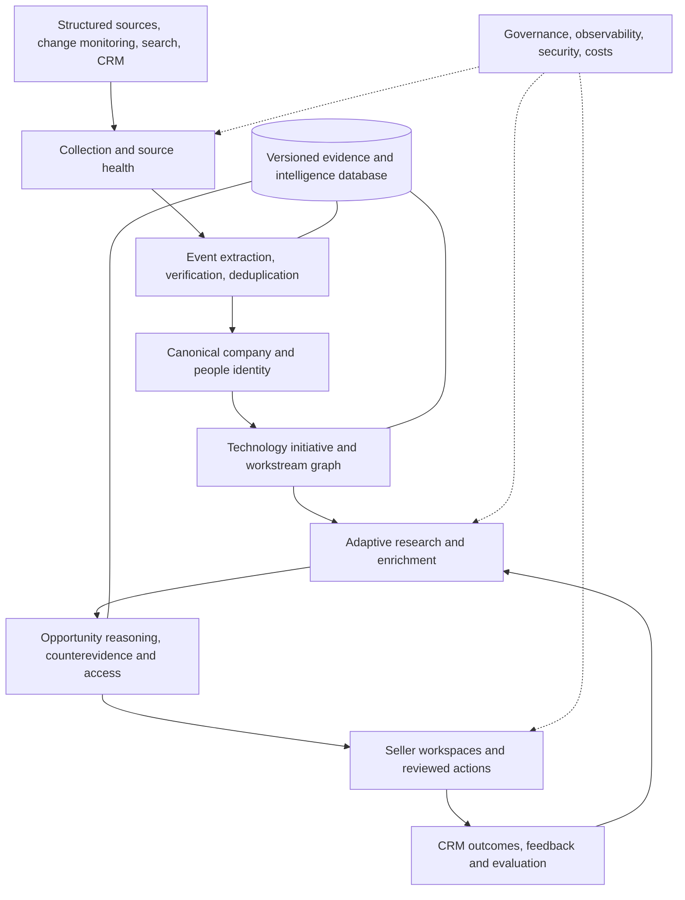

# THE CODEST — REVENUE INTELLIGENCE PLATFORM
## Final Production Architecture & System Design — Version 4.0

> **Status:** Target production architecture; no implementation or actual performance is implied. **Baseline:** 20 November 2026. **Owner:** The Codest business development / engineering leadership, to be assigned. **Primary purpose:** Find commercially accessible software-engineering work and improve progression from verified evidence through buyer engagement, procurement and signed delivery.

## 1. Vision and commercial contract

Build a durable, evidence-driven revenue intelligence platform, **not a generic news-alert or lead-scoring bot**. It should discover technology initiatives; identify possible external engineering work; explain the delivery, buying and supplier landscape; surface the correct relationship route; recommend an action; and retain intelligence through qualification, proposal, supplier onboarding, contract and revenue.

Five discovery routes must coexist: **direct purchasing demand** (tenders, RFPs, external contingent requests), **emerging engineering demand** (migration, integrations, cloud, AI and capacity events), **partner-led demand** (banks, vendors and systems integrators), **relationship-led demand** (CRM, former champions, reactivation), and **strategic pre-shortlist development** (programmes known before formal sourcing).

Every high-priority recommendation must answer, or explicitly mark unknown: (1) what happened, (2) which legal and operational entities are involved, (3) which actual workstream is implicated, (4) whether external demand is evidenced, (5) how The Codest might legally and commercially participate, (6) whom to approach, and (7) the next practical action. **Technology investment ≠ proven outsourcing demand.** Buying signals are evidence, not the commercial outcome.

## 2. Reference operating model

- Primary markets: **UK, Nordics, DACH; Poland for strategic banking**. Banking, payments, fintech and financial infrastructure first; enterprise SaaS, marketplaces and other delivery-fit sectors second.
- Internal ICP baseline: strategic major banks **5,000+ employees**; enterprise companies **1,000+**; established scale-ups **500–999**. Exceptions require an explicit rationale.
- Internal BDM operating baseline: **30 active + 10 reserve accounts**, ~**60% near-term / 40% strategic** prospecting allocation, ~**10 deeply researched accounts weekly**, reviewed outreach and follow-ups. These are configurable sales policies, not hardcoded architectural limits.
- Two existing Google Sheets are authoritative *input records*; **Pipedrive** owns organisation ownership, commercial activity and deal stages. The platform owns new events, claims, initiative hypotheses, research and review outcomes.
- Default posture: autonomous collection and suggested actions, **human approval** before outbound communication, consequential CRM writes, commercial commitments, contact-data credit spend or supplier applications.

## 3. Logical architecture

Eight domain modules: (1) Intelligence Collection, (2) Event and Signal Engine, (3) Company Identity, (4) Initiative Graph, (5) Adaptive Research and Enrichment, (6) Opportunity Decision Engine, (7) Sales Execution Intelligence, and (8) Feedback and Learning. These are software components; do not default to eight autonomous LLM agents.

## 4. Intelligence collection network

**A. Procurement and sourcing:** EU TED Search API, UK Find a Tender/OCDS, applicable national portals, authorised bank supplier portals and approved MSP/VMS sources. Distinguish planning, open, amended, award and expired notices; retain official notice identifiers, submission deadlines and eligibility. Public procurement is not exhaustive for private financial institutions.

**B. Engineering capacity:** Public ATS postings (Lever, Ashby, Greenhouse where supported), employer careers, contractor requisitions and relevant implementation vacancies. Track stable job IDs, creation, updates, closure, permanent vs contract, location and agency eligibility. Hiring may signal insourcing rather than outsourcing.

**C. Technology initiatives:** Company newsrooms, investor relations, engineering blogs, developer portals, official changelogs, appropriate public GitHub releases, company financial statements and public presentations. Match source type to evidentiary weight.

**D. Corporate identity and events:** GLEIF/LEI and relevant national corporate registers; filings, acquisitions, funding *with a specific use of proceeds*, corporate expansion and verified leadership changes.

**E. Vendor and partner ecosystems:** Core banking providers (e.g., Temenos, Mambu, Thought Machine, Finastra, Avaloq), payments technology (e.g., Form3, FIS, Adyen), integrators (e.g., GFT, CGI, Capgemini, Tietoevry), cloud ecosystems. These are monitoring candidates, **not confirmed customers, partners or buying opportunities**.

**F. Regulation and deadlines:** FCA, EBA, ECB, national supervisors, payment schemes and standard setters; interpret applicability to the named organisation, not merely an industry-wide deadline.

**G. Attention, access and relationships:** Public expert content and conference participation (Finextra, FinTech Futures, The Paypers, CTO Craft, LeadDev, EBAday, UK Finance, techUK, Bitkom, Copenhagen Fintech), existing CRM relationships and approved professional networks. **Attention ≠ intent; common event attendance ≠ confirmed personal relationship**.

**H. Dedicated strategic account monitoring:** Maintain source profiles for each master-list account: official site, newsroom, careers, supplier portal, engineering/developer pages, IR, known vendors and the supported signals each source covers. No accessible procurement source = **visibility unknown**, not “no procurement activity”.

Each source connector declares authentication, permissible use, fields, stable IDs, pagination, cursor, monitoring cadence, rate limits, failures, storage licence and cost. Prefer official API/feed; use targeted permitted change monitoring next; use semantic web discovery for unknown information and source expansion. Source coverage and health are distinct from signal absence.

## 5. Signal rule framework

Import all **64 existing rules** from `The Codest Buying Signal Tracker - Signals.csv`, preserving original ID, Group, Signal, Strength (0–3), Fresh for (days), Window note, How to spot it, Who to contact, Check it is real, Pairs best with and Stop effect. Families: REL, SRC, CAP, PRG, business events, leadership, regulation/deadlines and NEG. The project must preserve the original CSV and implement a versioned machine-readable extension; do not rewrite source truth.

Initial production monitoring should prioritise a **validated subset** of ~15–25 high-value rules rather than claiming 120 operational detectors. Expand after precision, coverage and cost checks.

Each rule has an ID/version, required event type and evidence, source mapping, positive and negative patterns, supported locations/languages, timing and expiry, correlation patterns, relevant buyer roles, Codest capabilities, disqualifiers and test fixtures. Example base anchors: `REL-03` contact changing company; `SRC-01` open relevant RFP; `SRC-04` prime programme award; `CAP-02` contract engineer; `PRG-01` core banking programme; `NEG-05` closed/reduced panel; `NEG-12` account ownership/non-circumvention restriction.

**Demand-evidence ladder:** D1 = confirmed purchasing process/stated external need; D2 = strong externally relevant hypothesis with corroborating evidence; D3 = verified engineering initiative; D4 = contextual/attention indicator. D1 is not itself a qualified CRM deal. Negative evidence applies independently. A second article repeating the same press release does not create independent corroboration.

## 6. Discovery and detection pipeline

Two loops feed one pipeline: **market-wide event-first** source queries and **account-targeted monitoring**. Search plans compose signal rule + sector + geography + language + time window + source class + technology, with stable plan IDs, successful-run cursors, query budgets and search yield histories.

Processing stages:
1. Acquire permitted source content and raw metadata.
2. Compute stable content identity/hash and differences; ignore unchanged documents.
3. Extract atomic factual events only; distinguish named entities and their roles.
4. Verify source provenance, original event date, publication date, status and whether the correct subsidiary is implicated.
5. Deduplicate repeated coverage, preserving linked source evidence.
6. Classify using versioned signal rules and determine evidence level.
7. Resolve account to the canonical registry and both master-list rows.
8. Correlate events into existing or newly proposed initiatives.
9. Open targeted commercial investigation tasks only where justified.
10. Generate alerts only for new or materially changed conclusions.

Track **event date**, **publication date**, **first discovery**, **last verification**, and where relevant **procurement closing / amendment dates** separately. Replayed runs must be idempotent. “No new signals” is invalid if the relevant collector failed.

## 7. Master-list integration and canonical identity

**Workbook A:** https://docs.google.com/spreadsheets/d/1J9vDQK3lQzZLP2tx2TkoHnQQQSFEA3-qRmXtoU4TX9Y/edit . Tabs: `MASTER ACCOUNTS`, `5000+ CORPORATIONS`, `UK`, `NORDICS`, `DACH`, `POLAND`, `BUYER CONTACTS`, `BUYING SIGNAL LOG`, `BUYER RESEARCH STATUS`.

**Workbook B:** https://docs.google.com/spreadsheets/d/1wJKkovlp4oFGo8aj3ayRlAH-oXZ4O-RGDK8LZme9EMc/edit . Tabs: `Accounts`, `Contacts`, `Contacts — Compact`, `New Account Research — Nov 20`, `Contact Research Queue`, `Priority Outreach`.

The deep links in earlier requests target individual tabs; import by **verified workbook schema**, not link `gid` alone. Record workbook ID + sheet ID + source row + import time, preserve original values, import as read-only initially and reconcile before proposing updates. Domains, registration IDs and LEIs outrank fuzzy names. Parent/subsidiary links must not be collapsed into one buyer or one procurement route. Ambiguous matches enter human review. Pipedrive remains source of truth for account owner and deal state.

## 8. Canonical data and evidence model

Required entities: `organizations`, `organization_aliases`, `organization_relationships`, `people`, `employment_history`, `relationship_history`, `sources`, `source_documents`, `claims`, `evidence_links`, `events`, `signals`, `initiatives`, `workstreams`, `supplier_relationships`, `procurement_routes`, `opportunity_hypotheses`, `sales_opportunities`, `recommended_actions`, `research_tasks`, `monitoring_runs`, `feedback`, `source_record_links`, `sync_cursors` and `audit_events`.

**Differentiate:** Company = entity; initiative = programme; workstream = actual technical scope; event = factual observation; signal = interpretation; claim = attributed assertion; opportunity hypothesis = possibility; buyer-confirmed need = confirmed commercial information; CRM deal = managed sales record. Never collapse these categories.

Claims store verbatim source anchor or precise excerpt, URL, source owner, retrieval date, publication date, verification and contradiction status. Preserve competing claims. Supplier relationships require scoped evidence and effective dates. Use a temporal graph-like relationship model over PostgreSQL initially; use separate graph infrastructure only if query requirements prove necessary.

## 9. Initiative intelligence

Create/update initiative records from named programmes, tender records, vendor implementations, corroborated event clusters or authorised CRM conversations. Every initiative records: owner entity, business goal, technical objective, technologies when verified, stage, milestones, workstreams, relevant legal entities, implementation vendors, incumbent coverage, supplier routes, buyer roles, evidence and confidence. Label invented working titles explicitly as *analyst working title*.

A core banking announcement can give rise to **three different potential counterparties:** the bank for direct workstreams, the platform vendor for implementation capacity, and the prime SI for specialist subcontracting. The platform should investigate each path independently and keep separate evidence and commercial barriers.

## 10. Enrichment waterfall

E1 **entity/ICP**: legal identity, domain, geo, segment, size with source; E2 **internal history**: master rows, contacts, account owner, CRM and relationship history; E3 **initiative/technology**: workstream, stack, milestone, hiring, vendors; E4 **commercial**: external supplier policy, MSP/VMS, eligibility, budget evidence and incumbent constraints; E5 **buyer/access**: workstream owner, sponsor, budget and procurement roles, existing introductions; E6 **contact/outreach**: verify current role and necessary business contact data *only after review and appropriate permission*.

Use existing records before paid enrichment. Make every field source-aware and time-bounded. Never infer a deliverable email from a naming pattern. Credit-consuming enrichment and access to personal contact data require prior explicit approval.

## 11. Adaptive research and bounded AI

AI task roles: factual extractor, signal classifier, ambiguous entity assistant, initiative analyst, research planner, opportunity analyst, counterevidence reviewer, buyer researcher, sales brief generator. Orchestrator sets tools, budgets, schemas, retries and stop conditions. Each research step asks: *Which unknown could change the commercial decision?* Prefer existing data, then official API, targeted retrieval, semantic search and only then deeper paid research. Stop at known next action, disqualification, inaccessible information, diminishing information value, budget or human decision boundary.

Use JSON schemas with rejection/retry on invalid structure and mandatory evidence linkage. Do not grant the reasoning model arbitrary permissions to write CRM, send messages or purchase credits.

## 12. Opportunity reasoning, states and scoring

Keep **evidence confidence**, **external demand evidence**, **supplier accessibility**, **time urgency**, **service fit** and **research completeness** separate. Illustrative weighted opportunity prioritisation: ICP 15, engineering relevance 25, external demand 20, buyer/supplier access 20, timing 10, relationship/delivery fit 10; these weights are hypotheses, not win probabilities. Hard blockers override ranking.

Intelligence states: `observed → verified → relevant → investigating → actionable_hypothesis → engaged → buyer_need_confirmed → commercially_qualified → proposal_procurement → contracted_delivery`, with `monitor`, `blocked`, `disqualified`, `expired`, `superseded`. Require evidence for every state transition; CRM deal stage is separate and authoritative in Pipedrive. High priority recommendations include supporting evidence, counterevidence, material unknowns and one recommended action with owner and objective.

## 13. Buyer access graph and sales plays

Access routes: existing CRM relationship; past champion moving role; verified introduction; programme technical owner; procurement owner; approved supplier portal; existing prime/implementation partner; public event and expert commentary (context only). Never assume people know each other based on a shared event.

Sales plays: specialist capacity, embedded engineering team, defined software workstream, payments integration, core-banking modernisation, cloud/data modernisation, AI assessment and pilot, prime subcontracting, approved supplier entry, re-engagement. Each play requires qualification gates, buyer roles, questions, approved Codest proof, procurement obstacles, disqualifiers and a realistic next step.

## 14. Sales-facing workspaces

- **Today:** 5–10 material changes by default, prioritised existing-list accounts, new opportunities, relationship reactivation, urgent procurement and active-deal blockers; zero findings is a legitimate result.
- **Account Intelligence:** account identity, source coverage, signals, initiatives, technology, suppliers, buyers, access, CRM history, research and changes since last review.
- **Opportunity Development:** outreach brief, discovery prep, confirmed needs vs assumptions, stakeholder map, procurement plan, technical scope, approved case evidence, next action and deal progress.
- **Market Explorer:** filters by source, company, geography, ICP, signal, technology, vendor, freshness, commercial status and owner.
- **Administration:** source failures, monitoring quality, cost, prompt/rule versions, access and audit logs.

Lead summary first (~150–250 words), then inspectable evidence and deep research on demand. A recommended next action must contain **owner, objective, rationale and due/trigger condition**. Avoid another dashboard that requires manual work to maintain.

## 15. Commercial execution and Pipedrive integration

Pipedrive owns organisation ownership, interactions and deal stages. Read incrementally via approved APIs/webhooks, deduplicate and respect colleague ownership. No autonomous prospect emails, sequencer enrolment, deal creation/stage changes, ownership reassignment, contact-credit spend, supplier application or commercial commitment. Provide a proposed write diff, authorisation, audit log and reconciliation outcome for approved changes. Connection loss degrades enrichment but must not stop public source collection.

The deal support flow covers first contact → reply → discovery → buyer-confirmed problem → procurement and budget validation → technical solution/internal feasibility → proposal → contracting → handover. A meeting does not automatically mean a qualified deal. Internal delivery capacity, case studies, price, start dates and external reference permissions require confirmation.

## 16. Reliability and evaluation

Quality gates must test source retrieval, permission and field contract; event extraction; temporal interpretation; source provenance; parent/subsidiary identity; event deduplication; initiative clustering; signal precision and recall; negative/counterevidence; buyer suitability; action quality; CRM idempotency; and regression after prompt changes.

**Proposed, unproven release targets:** 100% actionable factual claims with auditable source traceability; ≥98% company identity accuracy on a labelled corpus; <2% duplicate high-priority alerts in replay; zero unauthorised outbound/CRM writes; critical source failures visible; procurement deadlines checked at point of alert; measurable coverage and research costs. Use a labelled gold dataset of positive, negative, stale, contradictory and ambiguous cases. No provider can guarantee exhaustive internet coverage.

Run adversarial opportunity reviews for high-priority cases: correct entity? programme current? incumbent covers scope? external demand established? supplier eligibility? relevant proof approved? account ownership? what would falsify the hypothesis?

## 17. Security, privacy and governance

Classify data public/licensed/internal/confidential/personal; apply RBAC and least privilege, secrets management, audit logs, encrypted storage/transit, provider permissions, retention, deletion and lawful processing. EU/UK marketing rules, vendor licences and contact opt-outs control outreach eligibility separately from email validity. Never scrape private communities or bypass access controls. Keep sources and public/private evidence isolated in outputs. Use approved proof only; never imply the bank is a direct Codest client without clearance.

## 18. Operations and monitoring

Use durable scheduled and event-triggered workflows with idempotency keys, retries, dead-letter handling, cursor persistence, bounded concurrency, alerts and recovery runbooks. Monitor collection success, source freshness, changed docs, accepted events, duplicate rate, matched accounts, paid research escalations, unverified claims and cost. Daily urgent procurement and priority account checks; weekly strategic programme review; monthly source quality, signal and conversion review. Frequency is source-specific and must be budgeted. Reprocessed historical events must not be presented as new.

## 19. Revenue measurement and continuous learning

Trace: sources → verified signals → BDM-accepted recommendations → meaningful conversations → held discoveries → buyer-confirmed needs → supplier-path validation → qualified CRM opportunities → signed engagements → delivery starts → recognised revenue. Measure research spend, BDM time saved and false positives. Learn with reviewed cohorts and sufficient samples, not unvalidated model retraining after a few replies. Distinguish attribution from causation.

## 20. Initial seller operating standards

Use internal handbook as configurable organisation policy: 30 active + 10 reserve, 60/40 near-term vs strategic allocation, ownership protection, ~10 deep research accounts/week and reviewed outbound cadence. Monitor the larger universe without adding every signal to the active queue. New urgent and eligible opportunities may outrank lower-value existing accounts, but the system must protect account ownership and preserve reasons for reprioritisation.

## 21. Production example (illustrative; not a real lead)

A bank vendor announces a platform implementation. Official announcement is verified. Bank, vendor and integrator identities are matched to canonical records and existing spreadsheets. An associated engineering recruitment cluster supports an implementation-workstream hypothesis but not outsourcing demand. The graph tracks three possible buyers (bank, vendor, SI), a known prime award, programme milestones and supplier restrictions. The research planner verifies whether vendor implementation work might be subcontracted. Counterevidence rules downgrade direct-bank access. The platform recommends a **partner-route discovery conversation** with a relevant delivery owner, linked to original sources and Codest proof requirements. An approved CRM activity records the outcome; no deal is fabricated.

## 22. Production stack (proposed)

Next.js/TypeScript frontend; Python/FastAPI domain backend; PostgreSQL primary store, optional pgvector/full-text retrieval; object storage for permitted evidence; durable workflow/queue service; official API/feed connectors, Exa discovery adapter and approved page change monitoring; Pipedrive event-sync; optional Apollo contact enrichment; Slack/email digest; SSO/RBAC, KMS secrets, OpenTelemetry-style telemetry, backups and migrations. Use managed components where practical; avoid premature Kubernetes, multi-agent sprawl or graph-database operations.

## 23. Deployment and release design

Implement one approved architecture through gated production releases: **Foundation** (identity, data, permissions), **Collection** (connectors and coverage), **Initiatives** (event-signal-programme graph), **Opportunities** (adaptive research and commercial reasoning), **Buyer/access** (committee and sourcing), **Sales workspaces** (review and action), **CRM/deal** (approved integration), **Operational hardening** (replay and recovery). Every release needs automated tests, security and data review, operational dashboards, runbooks and acceptance evidence. “Production ready” does not mean turning on every untested source simultaneously.

## 24. Specifications and cross-reference

| ID | File | Purpose |
|---|---|---|
| 01 | [PRODUCT REQUIREMENTS](specifications/01_PRODUCT_REQUIREMENTS.md) | User outcomes, stories, permissions, product acceptance |
| 02 | [SOURCE INTELLIGENCE](specifications/02_SOURCE_INTELLIGENCE.md) | Exact collector and coverage contracts |
| 03 | [SIGNAL ENGINE](specifications/03_SIGNAL_ENGINE.md) | Versioned rules, classification, tests and negatives |
| 04 | [DATA AND IDENTITY MODEL](specifications/04_DATA_AND_IDENTITY_MODEL.md) | Entities, migrations, lineage and matching |
| 05 | [INITIATIVE INTELLIGENCE](specifications/05_INITIATIVE_INTELLIGENCE.md) | Temporal initiative graph and workstreams |
| 06 | [ENRICHMENT ARCHITECTURE](specifications/06_ENRICHMENT_ARCHITECTURE.md) | Progressive sourcing and buyer enrichment |
| 07 | [OPPORTUNITY REASONING](specifications/07_OPPORTUNITY_REASONING.md) | Hypotheses, state machine, challenges, priorities |
| 08 | [BUYER ACCESS AND SALES](specifications/08_BUYER_ACCESS_AND_SALES.md) | Stakeholder access, seller plays and progression |
| 09 | [INTEGRATIONS](specifications/09_INTEGRATIONS.md) | External systems, sync and write permissions |
| 10 | [USER EXPERIENCE](specifications/10_USER_EXPERIENCE.md) | Screens, interactions, filters and research UX |
| 11 | [SECURITY AND GOVERNANCE](specifications/11_SECURITY_AND_GOVERNANCE.md) | GDPR, RBAC, retention, external action gates |
| 12 | [RELIABILITY AND EVALUATION](specifications/12_RELIABILITY_AND_EVALUATION.md) | Gold-set evaluation, recovery and acceptance |
| 13 | [DEPLOYMENT AND OPERATIONS](specifications/13_DEPLOYMENT_AND_OPERATIONS.md) | Environments, workflow queues, SLOs and runbooks |
| 14 | [COST AND CAPACITY MODEL](specifications/14_COST_AND_CAPACITY_MODEL.md) | Provider budget and workload modelling |
| 15 | [IMPLEMENTATION PLAN](specifications/15_IMPLEMENTATION_PLAN.md) | Dependencies, release gates and definition of done |

## 25. Architectural decisions to retain

- Initiative/workstream, not company intent score, is the central commercial object.
- Sources are collected by method-specific contracts, not one generic AI search call.
- Market-wide **signal first**, with guaranteed target-account monitoring.
- Existing master lists take operational priority, but urgent new eligible work can surface.
- Supplier accessibility, negative evidence and alternative partner routes are required.
- Evidence/claim/interpretation/action are separate first-class records.
- Human approval gates all external communication and consequential writes.
- Observability, coverage, time validity and cost controls are part of the product, not later infrastructure tasks.
- Effectiveness is measured by buyer-confirmed, commercially feasible opportunities and eventual revenue; recommendations alone are not success.

## 26. Source and evidence boundaries

The following are source materials, not all independently revalidated at this document's creation:

- `The Codest Buying Signal Tracker - Signals.csv` — user-supplied 64 original signal rules.
- `The_Codest_NewBiz_Guidebook.pdf` — internal ICP, account ownership, review and commercial controls.
- `The_Codest_Complete_Sales_Playbook.md` and `The_Codest_Deep_Research_V2.md` — prior proposed account strategies and evidence caveats.
- `Pasted text(1).txt` — Buyer Intelligence & Intent Discovery Strategy, with Attention / Intent / Access distinction.
- Google Sheets workbooks above — live operational datasets; schemas and contents can change.
- Candidate official documentation: `https://docs.ted.europa.eu/api/latest/search.html`, `https://www.find-tender.service.gov.uk/`, `https://www.gleif.org/en/lei-data/gleif-api`, `https://developers.pipedrive.com/`, `https://docs.exa.ai/`, `https://docs.apollo.io/`, `https://help.lever.co/`, and vendor-specific ATS docs. **Verify current terms, versions, auth, coverage and costs during connector qualification.**

Do not turn previously reported survey statistics, particular company examples or vendor feature claims into new verified facts without rechecking their original sources. The system architecture is prescriptive and requires pilot evidence before claims of measured results.

## 27. Final acceptance standard

The production platform should allow a salesperson to ask: **Who deserves attention today? Why? Can we realistically win relevant engineering work? Who is the credible access path? What exact next action moves this toward revenue?** It must answer with evidence, uncertainty and operational traceability, or say the information is unavailable. That is the quality gate for the entire system.
